  

 

  

 

## `> ./hauptprojekt --info`

### 🔐 SecretCalc

Ein getarnter Messenger, der wie ein normaler Taschenrechner aussieht.

- React + Vite Frontend mit 4 Premium-Themes
- Node.js / Express Backend mit JWT-Auth
- PostgreSQL Datenbank
- Capacitor Android APK
- WebSocket Echtzeit-Chat
- End-to-End verschlüsselte Secret Chats mit PIN-Lock
- Admin Panel (User-Verwaltung, Ban/Unban)
- Automatische Backups + CLI Chat-Viewer

| Bereich | Technik |
|---|---|
| Backend | Node.js, Express, PostgreSQL, JWT, bcrypt |
| Frontend | React, Vite, Zustand, Dexie, TailwindCSS |
| Mobile | Capacitor, Android (APK) |
| DevOps | Docker, systemd |

## `> cat stack.txt`

## `> tail -f lernpfad.log`

| Zertifikat | Bereich | Status |
|---|---|---|
| AZ-900 | Azure Fundamentals | 🎯 In Vorbereitung |
| AZ-104 | Azure Administrator | 📅 Geplant |
| CCNA | Netzwerk | 📅 Geplant |

 

  

